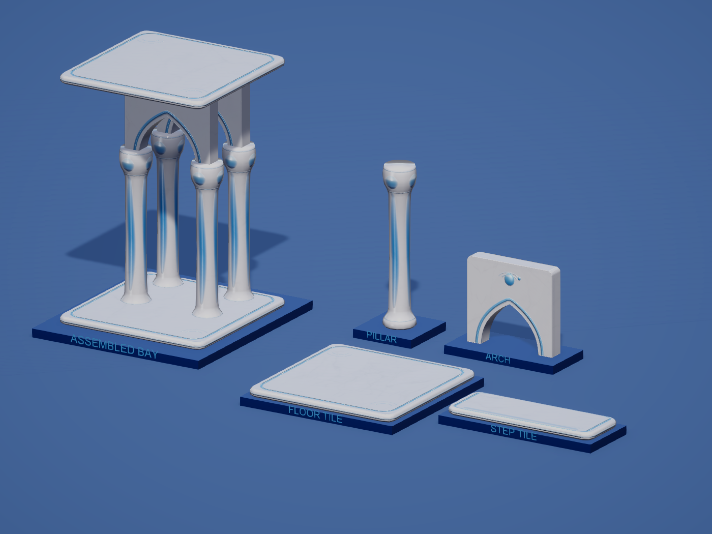
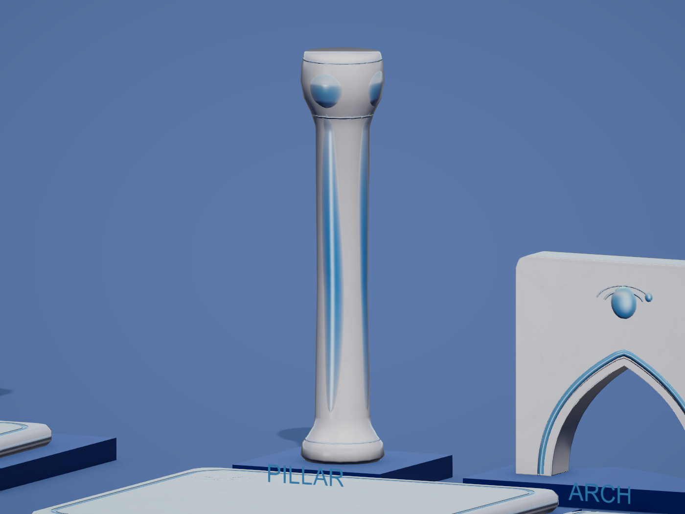

# Pearl shell Aero revision

Historical rejected visual revision, 2026-10-21. Superseded by [AQUATIC_ARCHITECTURE.md](AQUATIC_ARCHITECTURE.md), guided by the user-selected sample 2. Supersedes the classical ornament in [LOW_POLY_AERO.md](LOW_POLY_AERO.md), while retaining its low-poly budget.

The architecture references favor smooth white shells, blue glazing, rounded marine forms and broad glossy reflections. This pass moves the models closer to that direction: the literal fluting, acanthus petals and scrolls become four flowing blue enamel panels, a pearl-like rounded capital and bubble lenses. The arch has a broader blue opening band and an orbital bubble emblem. Tile borders are broader glazed lines, with soft ice-blue side trim and ripple marks. Gray marble veins remain subtle beneath the polished white finish. No green building colors are used.

The baked color maps now contain smooth white-to-blue enamel gradients and soft bubble crescents. The corresponding normal and AO maps come from new high-detail Blender source surfaces. The Unity shader adds clear coat, greater enamel smoothness, a soft cyan rim and restrained stylized sky/window reflections. The reflected highlight depends on the view and surface normal; baked color highlights provide the softer base gradient. Materials remain opaque, with no water animation or scene refraction.

| Model | Triangles | Smoothness |
| --- | ---: | ---: |
| Pillar | 444 | 0.89 |
| Arch | 288 | 0.88 |
| Floor_Tile | 92 | 0.90 |
| Step_Tile | 92 | 0.84 |

Blue enamel blends toward smoothness 0.96. Shared coat strength is 0.8, coat smoothness 0.95, sky sheen 0.5, marble-vein strength 0.16, fine grain normal strength 0.12, ornament normal strength 0.8 and AO strength 0.12. The four-model total remains 916 triangles. Normal maps provide relief shading; silhouettes and collision still use the low-poly meshes.

The prefab GUIDs, outer bounds, pivots, root scales, single-submesh/material structure, all eleven construction-stage slots and floor connection heights remain intact. The arch retains its full spandrel and open passage. No runtime scripts or prefab children were added.

## Source and review

- `ArtSource/Buildings/FrutigerAero/BuildingKit_AeroShells.blend`: current low-poly meshes and hidden high-detail bake sources in `Aero_PearlShellKit`; earlier scenes and separate source files are retained.
- `Tools/BuildingAero/build_aero_shells.py`: current Blender MCP authoring module; uses `build_lowpoly_baked.py` as a geometry/bake pipeline. Call `build()`, `bake_one(name)` for each model, then `finish()`.
- Current FBX files and `BakedAero/AeroLP_*` map paths are updated in place under `Assets/_Project/Models/Buildings/FrutigerAero/`; Unity asset GUIDs remain stable.
- `ApplyWhiteMarble.cs`, `ImportBuildingAero.cs` and `CaptureWhiteMarble.cs` apply and capture the current finish through Unity MCP. Capture outputs use the `AeroShell-*` prefix. Historical previews remain unchanged.
- `Assets/_Project/Scenes/BuildingAeroReview.unity` shows individual pieces and an assembled bay; it is outside Build Settings.

## Verification

No automated tests were created or run. Blender source inspection, Unity asset inspection, shader diagnostics, rendered-image inspection and the user-authorized final live Tower session were used.

- `AeroShellInspection.json`: mesh counts, original bounds/GUIDs, complete UVs/normals/tangents, matching stage meshes, maps and instancing; shader diagnostics empty.
- `AeroShellNormalInspection.json`: fixed-camera normal on/off comparison, retaining color and AO.
- `AeroShellTowerRuntime.json`: frames advanced; all 717 nearby pieces and 44 far-stage batches use the new maps/coat settings, with 83,912 distant instances loaded. All 98 nearby arch colliders have volume, a sampled passage is open and its upper panel is solid. Shader diagnostics empty.
- `AeroShellConsoleInspection.json`: no new runtime errors after the verification cursor.
- `AeroShellFinalEditorState.json`: original Tower scene restored clean in Edit Mode, Run In Background off.

The preserved triangle budget is measured. No new hardware performance benchmark or mobile build was performed.
