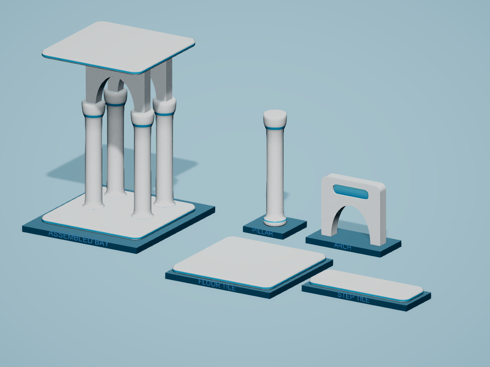

# Aquatic architecture revision

Current revision, 2026-10-21; awaiting user review. The user identified `Assets/_Project/References/Buildings/frutiger-building-sample-2.jpg` as the specific target after rejecting the pearl-shell version. This direction supersedes [AERO_SHELLS.md](AERO_SHELLS.md).

The reference supplies the seamless white frames, curved aqua recesses, polished surfaces and soft reflected water light. Green vegetation is excluded from the building kit under the standing palette constraint.

- Arch: rounded outer corners, a curved elliptical passage and actual shallow glazing pockets on both faces. The aqua panels sit inside beveled white surrounds. The full spandrel, flat top and floor connection height remain intact. Bubble badges, orbital engraving and raised blue opening wires are removed.
- Pillar: a continuous white support with restrained integral aqua collars, a smooth shaft and simpler bearing surfaces. Painted vertical streaks and bubble ornaments are removed. Fine shaft relief remains in its baked normal map.
- Floor and step: smoother rounded corners, uninterrupted white walking surfaces and aqua bands formed by the side geometry. Etched ripple decorations and overlay trim are removed.
- Materials: subdued marble, clear coat, working reflection-probe variants and subtle static water-light highlights. The older hand-shaped sky/window sheen is disabled. Glazing is an opaque polished approximation; the kit does not depend on transparent sorting or refraction.

| Model | Triangles | Previous dense rounded mesh |
| --- | ---: | ---: |
| Arch | 1,680 | 4,472 |
| Pillar | 764 | 5,564 |
| Floor_Tile | 284 | 556 |
| Step_Tile | 284 | 528 |
| One of each | 3,012 | 10,620 |

This uses more geometry than the rejected 916-triangle version for actual recesses and rounded edges, while remaining 71.6% below the earlier dense rounded kit. Outer dimensions, pivots, prefab GUIDs, root scales, one mesh/submesh/material per prefab, no children and all eleven stage meshes remain compatible. The arch passage shape is intentionally revised; its nonconvex collider uses the matching mesh.

Color boundaries on the pillar and slabs come from UV1 coordinates attached to the corresponding geometric faces. This avoids projection fringes at blue/white seams. Unique UV0 still supplies baked normals/AO and the arch's graduated panel color. Normal maps use short Cycles projection rays; the UV0 tangent basis remains MikkTSpace. Marble grain is triplanar, with vein strength 0.10 and fine normal strength 0.12. Baked normal strength is 0.65, AO strength 0.10, clear coat 0.55 and water-light strength 0.12. Water light is a static surface-light impression, not a physical aquarium simulation.

## Sources and review

- `ArtSource/Buildings/FrutigerAero/BuildingKit_AquaticArchitecture.blend`: current geometry and bake sources in `Aero_AquaticArchitecture`; older saved sources and scenes are retained.
- `Tools/BuildingAero/build_aquatic_architecture.py`: current Blender MCP source. Call `build()`, `bake_one(name)` for the four models, then `finish()`. It reuses the earlier geometry/bake helpers without rebuilding their historical scenes.
- `ImportBuildingAero.cs` and `ApplyWhiteMarble.cs`: Unity MCP import/material/prefab authoring.
- `TuneAquaticReview.cs`: dedicated review-scene lighting and baked studio reflection capture. Reflection fixtures use layer 31 and are hidden from the review camera. These fixtures, environment settings and studio materials are confined to the review scene and do not change Tower lighting.
- `CaptureWhiteMarble.cs`: current `AquaticArchitecture-*` images, including a perspective assembly view. Restores camera/material settings and disables asynchronous shader compilation during capture.

## Validation

No automated tests were created or run. Validation used source inspection, Unity asset inspection, shader compilation, rendered images and the user-authorized final live Tower session.

- `AquaticArchitectureInspection.json`: preserved bounds/GUIDs, complete UVs/normals/tangents, one submesh, all matching stage slots, instancing and empty shader diagnostics.
- `AquaticArchitectureNormalInspection.json`: fixed-camera normal on/off comparison, retaining color, AO and water light.
- `AquaticArchitectureTowerRuntime.json`: advancing frames, 717 nearby pieces and 83,912 distant instances; all 44 far-stage batches use the new meshes and material settings. All 98 nearby arch colliders have volume. A sampled passage is open, with a solid upper panel and leg. Shader diagnostics are empty.
- `AquaticArchitectureConsoleInspection.json`: no new runtime errors after the verification cursor.
- `AquaticArchitectureFinalEditorState.json`: clean Tower scene restored in Edit Mode, Run In Background off.

The triangle reduction is measured. No hardware frame-rate benchmark or mobile build is claimed.
