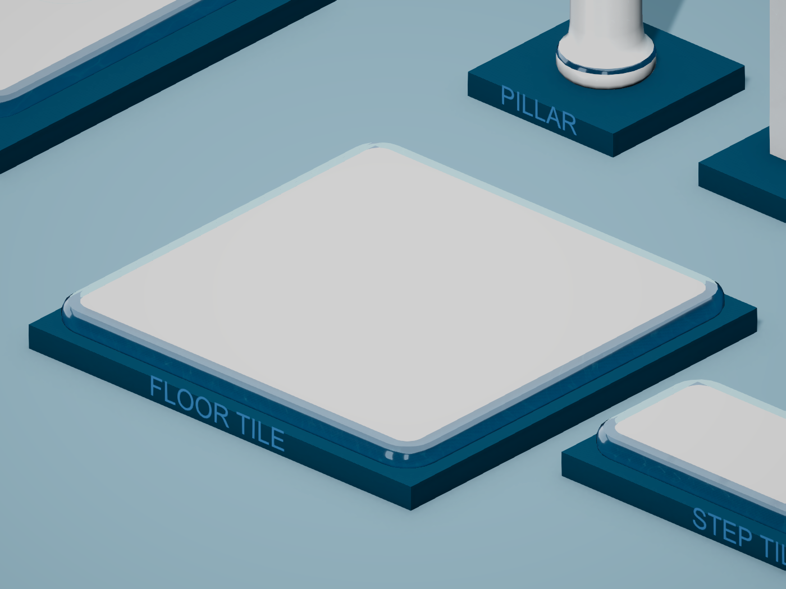
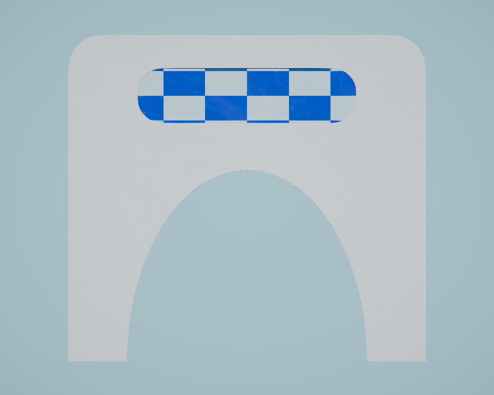

# See-through building borders

**Rejected by the user; inactive.** The previous [opaque aquatic finish](AERO_FLOW_SHADER.md) has been restored. The glass keyword is disabled on all four presets, and the glass feature is removed from both renderers. The implementation, captures and configuration steps below are historical; do not reapply them unless the user asks.

2026-10-21. The user asked for borders that read as glass after the opaque aquatic finish. The existing rounded white architecture is retained; the aqua panels, collars and 0.12 m slab borders now transmit the opaque scene behind them, with refraction, dielectric reflections, blue absorption and faint moving water light. Source meshes, prefab hierarchy, materials, construction stages and colliders remain compatible.

## Rendering

`BuildingAquaticFinish.shader` keeps the white core in its normal opaque pass. When `_AERO_BORDER_GLASS` is enabled, matching glass regions are omitted from forward, shadow, depth and depth-normal passes. Its new `GlassBorders` pass (`LightMode=AeroGlassBorder`) draws these regions after the opaque scene-color copy and before other transparent objects. It reads that copy rather than the active color attachment, and writes no depth. There is one mesh, submesh and material per building; no transparent overlay child is added.

`Assets/_Project/Scripts/Rendering/BuildingGlassRendererFeature.cs` supplies the additional Render Graph draw. Both `PC_Renderer.asset` and `Mobile_Renderer.asset` include the feature. A separate `TowerOfBabel.Rendering` assembly references URP/Core without adding rendering dependencies to gameplay. The project already enabled opaque/depth textures, so those pipeline settings remain unchanged.

The refracted ray offset is shallow, clamped to 2.5% of the screen and rejected if it would pull a foreground silhouette over the surface. Transmission is tinted by optical thickness and view angle. Fresnel reflections strengthen at grazing angles, while very bright studio probe highlights are limited to preserve the transmitted scene. The previous animated ripple/caustic fields remain independently randomized per instance.

Above the existing 85 m water-detail distance, the glass pass discards and the core renders the previous opaque finish. Both passes use the same instance-origin distance and mask. This prevents holes in the distant kit. The extra glass draw still submits geometry; no frame-time benchmark or device build has been performed.

This is screen-space glass: it transmits the opaque scene color and sky captured by URP. Other transparent objects and additional glass layers are not included in that snapshot. There is no ray tracing, physical volume, internal multiple reflection or world caustic projection. The feature requires Unity 6 URP Render Graph. The keyword can be disabled to restore opaque glazing on another renderer.

Unity references: [custom rendering in URP](https://docs.unity.com/en-us/engine/6000.3/manual/render-pipelines/universal-render-pipeline/customizing-urp), [Render Objects pass filtering](https://docs.unity.cn/6000.0/Documentation/Manual/urp/renderer-features/renderer-feature-render-objects.html), [opaque scene texture](https://docs.unity3d.com/6000.3/Documentation/Manual/urp/universalrp-asset.html). Installed URP source was also inspected to verify pass order, resource APIs and the lit renderer-list pattern. The feature is independently implemented.

## Controls and authoring

| Material | Transmission | Optical thickness |
| --- | ---: | ---: |
| Arch | 0.86 | 0.120 m |
| Floor | 0.91 | 0.085 m |
| Pillar | 0.87 | 0.100 m |
| Step | 0.92 | 0.065 m |

Common values: refraction 0.8, refractive index 1.45, tint `(0.68, 0.93, 1.0)`, border width 0.12 m, border mask strength 1. The per-model finish and animated water controls in [AERO_FLOW_SHADER.md](AERO_FLOW_SHADER.md) remain available. The saved motion clock is -1.

Run `Tools/BuildingAero/ConfigureBorderGlass.cs` through Unity MCP in Edit Mode to configure the two renderer features and four existing presets. If rebuilding the earlier kit with `ApplyWhiteMarble.cs`, run `ConfigureBorderGlass.cs` afterward. The regular review stills from `CaptureWhiteMarble.cs` now use the `BorderGlass-*` prefix.

## Verification

No automated tests or Play Mode sessions were run for this revision. Validation used Unity compilation, shader diagnostics, code review and authoring renders. Compilation and shader diagnostics are clean. The new rendering assembly initially needed explicit URP/Core references; these were added before configuration. A domain-reload connection reset recovered after the Editor reached ready.

- [BorderGlassConfiguration.json](BorderGlassConfiguration.json): feature references, material keyword, transmission, thickness and instancing.
- [BorderGlassAssetInspection.json](BorderGlassAssetInspection.json): unchanged 3,012-triangle kit, prefab GUIDs, one mesh/submesh/material per asset, eleven matching stages, enabled glass keyword and live clock -1.
- [BorderGlassCaptureInspection.json](BorderGlassCaptureInspection.json): fixed camera and motion clock, two checkerboard backgrounds, opaque control, `Graphics.RenderMeshInstanced` at the same transform, distant fallback and restored material state. Temporary objects and callbacks are removed afterward.
- [BorderGlassImageInspection.json](BorderGlassImageInspection.json): the pane responds to changing scenery, while the opaque control and white core remain stable. The instanced pane matches the MeshRenderer capture. A 100 m orthographic capture retains opaque glazing.
- [BorderGlassConsoleInspection.json](BorderGlassConsoleInspection.json): final compilation/console state; existing FishNet obsolete-API warnings remain.
- [BorderGlassFinalEditorState.json](BorderGlassFinalEditorState.json): original saved Tower scene restored in clean Edit Mode, background settings off.

The pattern comparison is a rendering inspection, not an automated test or a performance benchmark. Desktop rendering was inspected; the mobile renderer is configured but has not been verified on a mobile device. Earlier live Tower counts in the aquatic-finish reports predate this glass pass.

The inset background comparison changes all 30,616 sampled glass pixels by more than two color levels. The opaque control changes zero; the 15,500 sampled white-core pixels also change zero above that threshold. The instanced comparison differs by a mean of 0.007 channel levels. The far fallback's color differs from the close opaque control because its water detail has faded. The capture helper warms the renderer after material keyword changes; preliminary captures made before batching settled were replaced.

## Render Graph review

1. **Validation summary:** inputs and draw order match the shader; authoring transmission and instanced captures render without graph errors.
2. **Confirmed issues:** the initial assembly lacked URP/Core references; corrected with its own assembly definition. No unresolved resource-wiring issue found.
3. **Risky assumptions:** screen-space transmission cannot include later transparent draws; overlapping glass layers are approximate. Compatibility mode and target-device performance are unverified.
4. **Recommended fixes:** none outstanding for the current desktop Render Graph path. Disable the keyword if using a renderer without this feature.
5. **Corrected snippets:** the pass declares `ConfigureInput(Color | Depth)`, explicitly reads the opaque/depth textures, writes active color, binds depth for read-only testing and uses a static renderer-list callback. Published lighting/probe textures follow URP's own `DrawObjectsPass` global-texture pattern; no new global texture or color copy is published.
6. **Missing information:** device/build performance and multilayer transparent-scene requirements have not been supplied or measured.
