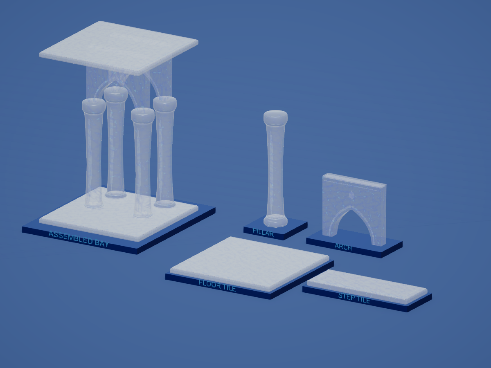
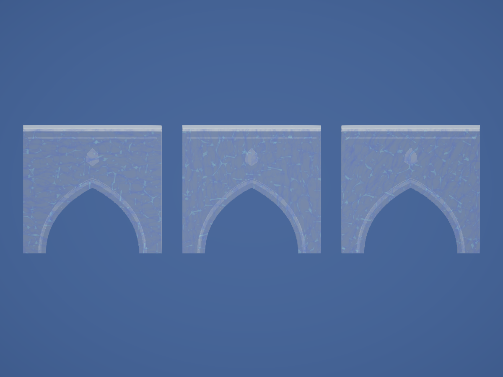
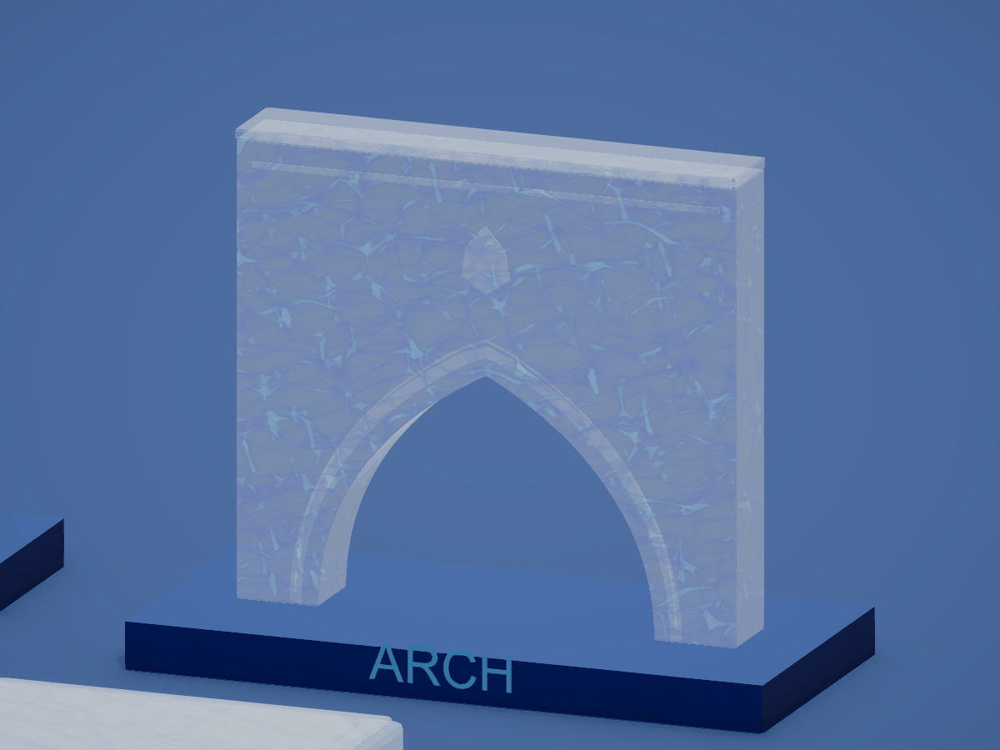

# Randomized layered water glass

Superseded by the user's white marble direction. See [MARBLE.md](MARBLE.md) for the active material; this page preserves the previous experiment.

Current Unity material revision, 2026-10-21. This supersedes the two-layer material shown in the `WaterGlass-Inner-*` previews. The building palette remains white and blue only.

## Model presets

Each model has its own material, all using `TowerOfBabel/Buildings/Water Glass`. The original prefab GUIDs, meshes, construction stages, colliders and single-submesh structure are retained.

| Model | White shell opacity | Base transparency | Near water layers | Internal depth | Flow speed |
| --- | ---: | ---: | ---: | ---: | ---: |
| Arch | 23% | 77% | 6 | 0.28 | 0.70 |
| Floor_Tile | 50% | 50% | 5 | 0.12 | 0.52 |
| Pillar | 34% | 66% | 6 | 0.35 | 0.62 |
| Step_Tile | 40% | 60% | 4 | 0.09 | 0.85 |

Transparency here describes the white shell facing the viewer. Final pixel opacity also includes water coverage and the stronger grazing-angle glass rim. Floors deliberately remain more milky; arches are the clearest. Pillars have greater depth spread than the flat pieces.

The materials are `Aero_WaterGlass_Arch`, `Aero_WaterGlass_Floor_Tile`, `Aero_WaterGlass_Pillar` and `Aero_WaterGlass_Step_Tile` in `Assets/_Project/Models/Buildings/FrutigerAero/`. `Aero_BuildingAtlas` remains an authoring template/fallback.

## Pattern and depth

Per-instance phase, rotation, offset, scale and flow speed are derived from the object's world origin, quantized to 1/32 metre, together with its model seed. A building keeps the same seed when reinstantiated at the same location or switched between near and far rendering. The shader does not use batch instance IDs, add scripts, or create individual material copies for each building. Relocating a building changes its pattern; two objects at exactly the same transform and with the same model seed intentionally share it.

Water samples are positioned at successive depths along a refracted view ray, each with its own scale, counterflow and deformation. They composite from front to back with depth-dependent color extinction, rather than flattening into one maximum-value pattern. Deeper samples soften. An animated internal ripple normal bends the transmitted view, while the outer glass geometry stays fixed. Fresnel reflections preserve a white glass rim. Refraction fades near screen boundaries and rejects opaque foreground pixels.

Nearby pieces use their configured 4–6 layers. Beyond 42 metres the shader uses at most three, and beyond 70 metres it uses two. The far renderer still uses its existing 44 stage batches; there are no extra geometry passes. More texture samples increase fragment cost; no hardware performance benchmark or mobile build was performed.

## References used

- [tuxalin/water-shader](https://github.com/tuxalin/water-shader), especially its [depth color extinction](https://github.com/tuxalin/water-shader/blob/master/shaders/hlsl/water/depth.cginc), [Fresnel radiance](https://github.com/tuxalin/water-shader/blob/master/shaders/hlsl/water/radiance.cginc) and wave-normal treatment. Its README lists caustics as future work; the building caustic field is generated by this project.
- The installed project's `Assets/Stylized Water 3/Shaders/Libraries/`: inspected `Caustics.hlsl`, `Normals.hlsl`, `Refraction.hlsl` and `Depth.hlsl` for layered motion, refracted scene color and depth handling. The building implementation is independent and does not copy the package code or depend on its includes, materials or textures.

The shader uses standard Snell refraction, Schlick Fresnel and exponential absorption equations in the project's URP implementation. This remains a stylized depth-layer approximation. It does not simulate a fluid volume, and opaque scene-color refraction cannot refract additional transparent surfaces. Depth writing remains on for the large instanced tower, so intersecting transparent surfaces have approximate ordering.

## Authoring and verification

- `Tools/BuildingAero/ApplyWaterGlass.cs` creates/updates the four presets, remaps FBX materials and assigns prefab renderers through Unity. Run in Edit Mode with Unity MCP.
- `Tools/BuildingAero/CaptureLayeredWater.cs` captures the kit, a two-layer comparison, animation frames and three identical arch instances. Temporary instances and camera/material overrides are restored afterward.
- `Tools/BuildingAero/make_glass_preview.py --layered` assembles the captured animation and records live motion differences.

Inspection reports: `LayeredWaterMaterialsInspection.json`, `LayeredWaterMotionInspection.json`, `LayeredWaterTowerInspection.json`, `LayeredWaterConsoleInspection.json` and `LayeredWaterFinalEditorState.json`. Validation used compiler diagnostics, static review, image inspection and the user-authorized Play Mode sessions. No automated tests were created or run.

In the live Tower scene, all 717 nearby pieces and all 44 distant stage batches used the matching model presets, with 83,912 distant instances loaded. Normal engine-time animation was confirmed with a fixed camera; all material preview clocks were restored to −1. Shader compiler messages were empty. The final editor is restored to the clean Tower scene in Edit Mode, with Run In Background off.
