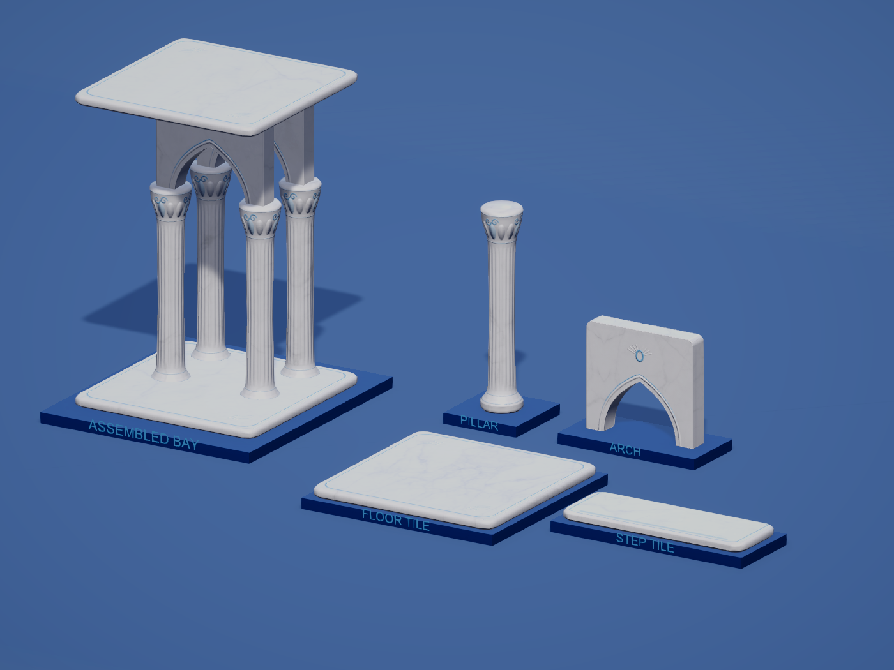
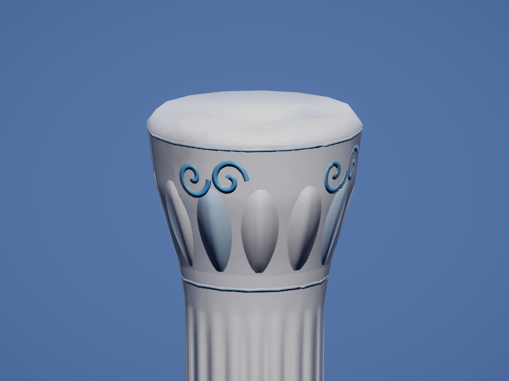

# Low-poly classical Aero kit

Historical classical ornament revision, 2026-10-21. The current [pearl shell Aero revision](AERO_SHELLS.md) retains this low-poly budget and supersedes its surface details.

The two supplied classical-column photographs inform the fluted shaft, paired capital scrolls and raised petal ornament. The project's ten architecture references inform the polished white shells, soft blue enamel and marine shapes. Gray-veined white marble remains the main texture; green is excluded from the building colors.

| Model | Previous triangles | Current triangles | Reduction |
| --- | ---: | ---: | ---: |
| Pillar | 5,564 | 444 | 92.0% |
| Arch | 4,472 | 288 | 93.6% |
| Floor_Tile | 556 | 92 | 83.5% |
| Step_Tile | 528 | 92 | 82.6% |
| One of each | 10,620 | 916 | 91.4% |

The pillar uses a 16-sided tapered shaft and bell capital. Rounded slab profiles, corner cuts and the full arch spandrel remain actual geometry. Fine flutes, scrolls, pearl petals, raised arch moulding, a shell medallion, tile borders and tread details come from high-detail source meshes baked onto the low-poly meshes. Normal maps change lighting, not silhouettes or collision.

Each model has a baked surface-color map, tangent-space normal map and ambient-occlusion map in `Assets/_Project/Models/Buildings/FrutigerAero/BakedAero/`. The pillar maps are 2048 square; the other maps are 1024 square. Unity imports normal maps as linear Normal Map textures without flipping green, calculates MikkTSpace tangents, and retains both authored UV sets. UV0 holds unique bake islands; UV1 retains the palette coordinates. Secondary lightmap UV generation is disabled to preserve UV1.

The shared Unity marble shader combines this baked ornament with the supplied marble texture and its finer triplanar grain normal. Baked normal strength is 1, fine grain strength 0.3, AO strength 0.25 and gray-vein strength 0.42. The four existing material presets retain slightly different polish. Lighting and depth normals both use the relief. Opaque rendering and GPU instancing remain active.

All four prefab paths and GUIDs, pivots, outer bounds, root scales, gameplay references and eleven construction-stage slots are preserved. Every stage uses its model's low-poly mesh. There is one root renderer, mesh, submesh and material per prefab, with no children or new runtime components. Floor/step box colliders and the pillar capsule remain; the arch's nonconvex MeshCollider uses the new mesh and keeps its passage open. The flat arch top still meets the next floor.

## Editable source

- `ArtSource/Buildings/FrutigerAero/BuildingKit_LowPoly.blend` contains the low-poly lineup and hidden high-detail bake sources in `Aero_LowPolyBuildingKit`. Earlier scenes are retained. The older `BuildingKit.blend` is preserved separately.
- `Tools/BuildingAero/build_lowpoly_baked.py` defines geometry, UVs, Cycles bakes and FBX export. Load through Blender MCP, call `build()`, `bake_one(name)` for each model, then `finish()`. It imports geometry helpers from `build_assets.py` without executing that script's scene-building body.
- `Tools/BuildingAero/ImportBuildingAero.cs` imports the FBX files and rebinds prefab/stage/collider meshes through Unity MCP.
- `Tools/BuildingAero/ApplyWhiteMarble.cs` applies texture settings and current material presets through Unity MCP.
- `Tools/BuildingAero/CaptureWhiteMarble.cs` produces `LowPolyAero-*` review images and restores camera/material settings.

Re-export from the low-poly authoring source; running the older `build_assets.py` rebuilds the superseded rounded geometry. High-detail bake sources are not exported into gameplay FBX files.

## Inspection

No automated tests were created or run. Validation used Blender geometry inspection, Unity asset inspection, shader compilation, image comparison and the user-authorized live Play Mode inspection.

- `LowPolyAeroInspection.json`: triangle counts, preserved dimensions/GUIDs, all eleven stage meshes, complete normals/tangents/UVs, single submesh, baked maps and instancing. Shader diagnostics empty.
- `LowPolyAeroNormalInspection.json`: fixed-camera normal-map on/off comparison; only normal strengths change, with color and AO retained.
- `LowPolyAeroReviewRuntime.json`: advancing review frames, open arch passage, solid upper panel and solid leg.
- `LowPolyAeroTowerRuntime.json`: 717 nearby pieces, 83,912 distant instances in 959 chunks, all 44 far-stage batches using the new meshes/maps, and all 98 nearby arch colliders with volume. Shader diagnostics empty.
- `LowPolyAeroConsoleInspection.json`: no new runtime errors after the validation cursor; Unity reports no compilation failure.
- `LowPolyAeroFinalEditorState.json`: original Tower scene restored, clean Edit Mode, Run In Background off.

These inspections establish compatibility in the current desktop Editor. Triangle reduction is measured; no frame-rate improvement is claimed from a hardware benchmark.
