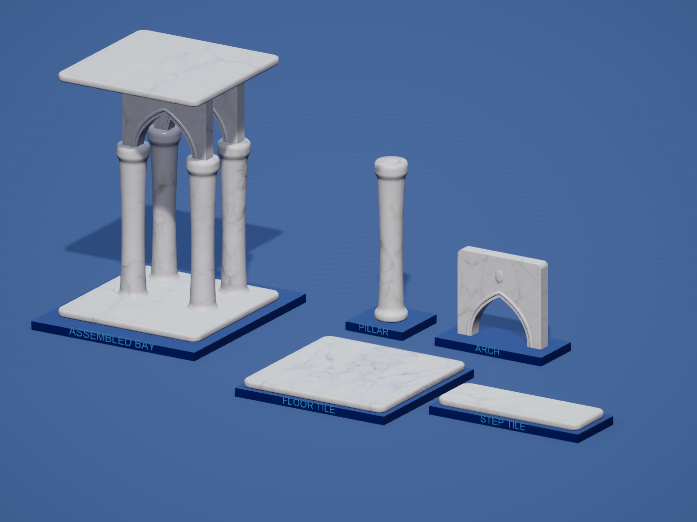
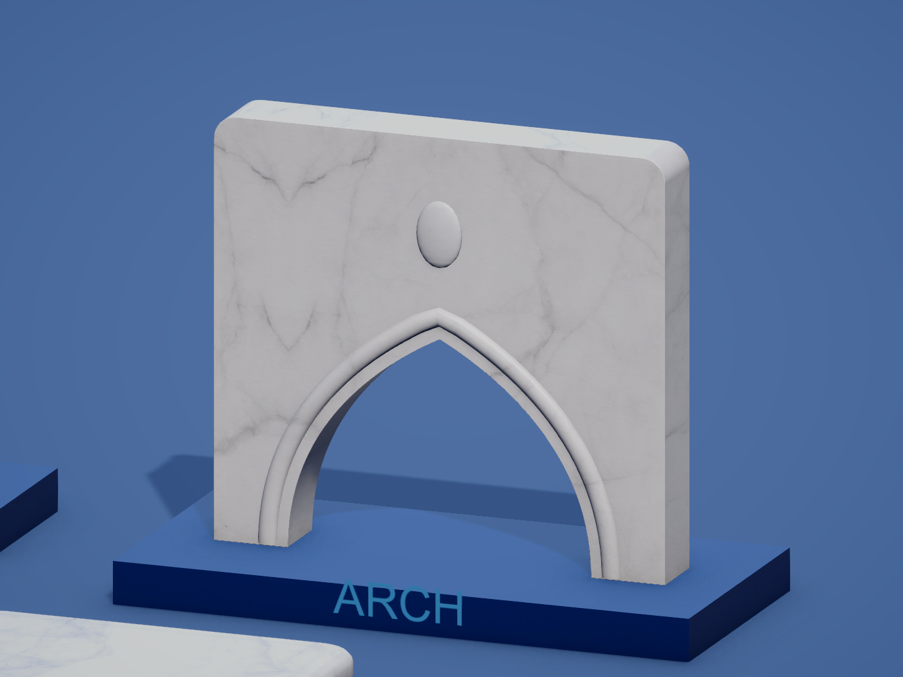

# Rounded white marble building finish

Historical material/rounding iteration. The current geometry, ornament maps and settings are documented in [LOW_POLY_AERO.md](LOW_POLY_AERO.md).

Current material direction, 2026-10-21: return the four building models to white, using the supplied white/gray marble reference. This supersedes the transparent glass and animated water experiments.

Latest revision rounds the actual geometry and adds a baked marble normal map. Earlier `Marble-*` images show the flatter models; `RoundedMarble-*` images are current.

The user's original image is preserved at `Frutiger Reference/Asset/Building-White-Marble-User.png` and imported directly as `Assets/_Project/Models/Buildings/FrutigerAero/Aero_WhiteMarble.png` (2048 × 1365). No generated substitute texture was used.

The opaque `TowerOfBabel/Buildings/White Marble` shader maps that image across all faces with triplanar projection, preserving the existing palette UVs for restrained blue inlays. Mirror wrapping avoids hard texture boundaries, and the original image aspect is respected. A deterministic per-building offset varies the vein placement. The surface is static, fully opaque, dielectric stone; it has no water, animated caustics, transmission or refraction.

Gray vein strength is 0.75, texture scale 0.28 repeats per metre, and blue inlay strength 0.16. Polish varies slightly: Arch 0.72, Floor_Tile 0.76, Pillar 0.70, Step_Tile 0.65. The shader uses URP PBR lighting, shadows, depth and depth-normal passes. It supports GPU instancing and uses one material/submesh per model.

## Rounded geometry and normal map

- Floor and step: rounded solid perimeter profiles and 0.23-metre corner radii. The step corners compensate for the existing prefab depth scale, so they remain rounded after scaling. Walking surfaces remain flat.
- Pillar: fuller, smoothly interpolated shaft with continuous rounded base and capital, replacing overlapping rings and flat inset strips.
- Arch: rounded upper corners, a wider five-segment edge fillet, raised curved moulding around the opening and rounded keystone relief. The full spandrel and flat upper bearing remain.

`Aero_WhiteMarble_Normal.png` is a 2048 × 1365 tangent-space normal map baked through Blender Cycles from subtle marble-vein relief and fine mineral grain. `bake_marble_normal.py` reproduces it. Unity imports it as a linear Normal Map with no green-channel flip. The shader projects its relief in three planes, accounts for mirrored-repeat directions, and applies it to PBR lighting and depth normals. Strength is 0.85 on all four materials. It supplements the actual mesh curvature rather than replacing it.

The normal-map on/off comparison changes 29,818 pixels by more than one color level at the same fixed camera, confirming a visible but restrained shading contribution (`RoundedMarbleNormalInspection.json`). The map is intentionally shallow to retain polished stone rather than a rough rock surface.

| Model | Current triangles | Original material-revision triangles |
| --- | ---: | ---: |
| Arch | 4,472 | 1,708 |
| Floor_Tile | 556 | 328 |
| Pillar | 5,564 | 2,912 |
| Step_Tile | 528 | 300 |

Curvature increases geometry cost. The current desktop runtime was inspected; no hardware performance benchmark or mobile build was performed.

Current materials: `Aero_WhiteMarble_Arch`, `Aero_WhiteMarble_Floor_Tile`, `Aero_WhiteMarble_Pillar`, `Aero_WhiteMarble_Step_Tile` under `Assets/_Project/Models/Buildings/FrutigerAero/`. Prefab GUIDs, outer dimensions, pivots, gameplay references, root scales and eleven construction-stage slots are retained. Every stage uses the corresponding rounded mesh. Box/capsule colliders are retained; the arch MeshCollider is rebound to its new mesh. FBX material remaps also point to marble. Previous glass materials remain as unassigned iteration history.

Authoring: `Tools/BuildingAero/ApplyWhiteMarble.cs` applies the material/import settings through Unity MCP in Edit Mode. `CaptureWhiteMarble.cs` captures the review views and restores the camera. `ImportBuildingAero.cs` now prefers marble materials when present.

Validation used image inspection, shader compilation, static review and the user-authorized Tower Play Mode session. All 717 nearby pieces and all 44 far-stage batches used the opaque marble presets; 83,912 distant instances remained loaded. Frames advanced and shader diagnostics were empty. Console and final editor state are recorded in `MarbleConsoleInspection.json` and `MarbleFinalEditorState.json`; material and runtime details are in `MarbleMaterialsInspection.json` and `MarbleTowerInspection.json`. No automated tests were created or run. The original clean Tower scene is restored in Edit Mode with Run In Background off.

The subsequent rounded-mesh verification confirmed all stage meshes, bounds and normal assignments (`RoundedMarbleInspection.json`); an open arch passage, solid panel and solid leg in Play Mode (`RoundedMarbleReviewRuntime.json`); and all 98 nearby arch colliders with nonzero volume, plus matching normal maps and rounded geometry in all 44 far batches (`RoundedMarbleTowerRuntime.json`). No new console errors occurred (`RoundedMarbleConsoleInspection.json`). Final state is recorded in `RoundedMarbleFinalEditorState.json`. The Edit Mode collision backend initially reported empty bounds, so collision conclusions come from the live Play Mode inspection.
