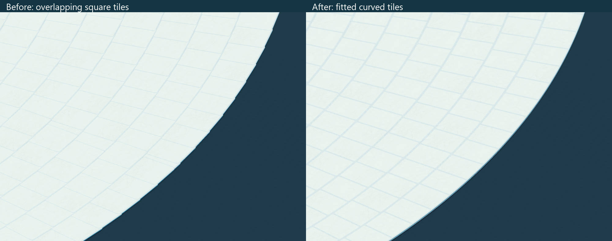
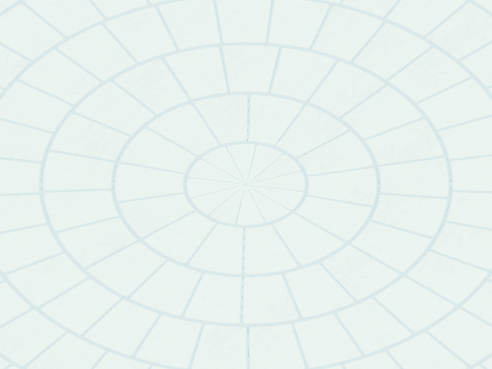

# Fitted radial tower floors

**2026-10-24 update:** the original inset six-span finished slab and per-tile glazing borders described below are superseded by the shared flush 16-span marble/glass slab and continuous floor shading. Distant pages also supplement missing glass models and use the safe 511-instance limit. See [current tile visibility and joins](TILE_VISIBILITY_AND_JOINS.md). The layout and construction data remain intact; the following records the original radial conversion.

2026-10-21. Current floor geometry/layout revision, retaining the restored [opaque aquatic finish](AERO_FLOW_SHADER.md). The user requested better tiling because the previous square floor pieces overlapped heavily in the circular generator. Arch, pillar and step geometry are unchanged. The building palette remains white and blue; see-through glass remains disabled.



## Cause and result

The generator's base radius is 96 m, angular setting 2 degrees and ring depth 3.9 m. That means approximately 3.351 m of arc spacing, while the old squares were 4 m wide. The fixed squares also collided as neighboring pieces rotated around each ring. A per-piece height increment of 0.0001 m had hidden some coincident faces, producing a sloping/stacked surface rather than fixing the footprint.

The new layout uses annular sectors with a whole number of pieces in every ring. Each ring closes at 360 degrees; the final ring tapers into the centre. Every tile top is at the same floor height. The generator's existing per-level radii, 6 m level pitch, 0.2 m floor datum and staircase locations are retained. Stair headroom openings are rebuilt from the existing stair positions.

The floor template was rebuilt in Blender with straight joining edges, a 4 mm top bevel, six angular spans, a white walking surface and the existing aqua side band. It has **136 triangles instead of 284** (52.1% fewer), with rebaked color, normal and AO maps. Its prototype bounds and corner pivot remain X 0–4, Y −0.2–0, Z −4–0. In the tower it is fitted to the dimensions of each sector. The root prefab still has one MeshFilter, one MeshRenderer, one material, one submesh, no children and eleven construction stages.

The saved Tower cache contains **47,472 fitted floor pieces**, compared with 47,069 old squares. All **37,560 non-floor assets** retain their poses, scales, types and construction stages. Total cached assets are 85,032 in 965 chunks. Cache-local indices are regenerated as part of this authoring rebuild; this is a new floor layout, not a live migration of an existing network session.

## Shared geometry and rendering

`TowerFloorLayout.Build` computes an integer sector count from ring circumference and target arc length, clips the last radial depth to the remaining radius, and encodes dimensions in the ordinary tile transform. It removes the per-tile Y increment. For a local point `(x,y,z)`, the shared mapping uses:

```text
r = outerRadius - x * scaleX
angle = -z * scaleZ / outerRadius
localX = (outerRadius - r * cos(angle)) / scaleX
localZ = -r * sin(angle) / scaleZ
```

Y is unchanged. Normals and tangents use the corresponding deformation derivatives.

- Nearby pool instances share CPU-bent meshes by ring shape. The MeshFilter and nonconvex MeshCollider use the **same mesh**, so rendering, interaction outlines and walking surfaces agree. Pool activation and stage changes reapply the correct shape. Original patch coordinates are retained in UV channel 2 for the material mask.
- Distant instances keep one common template mesh. `BuildingRadialFloor.hlsl` performs the same mapping from each instance transform. No separate model/material batch is needed for every radius; the existing eleven floor construction-stage batches remain instanced.
- `_RadialFloor` is 0 on the source material/prototype, 1 on far-renderer clones and 2 on near-renderer clones using pre-bent geometry. Other model types stay at 0.
- Far culling bounds include the inward bulge of the curved patch. All saved floor shapes were inspected against those bounds; none fell outside them.
- The floor root's box collider is replaced by a mesh collider. Generated authoring objects also use the bent mesh. The step retains its original geometry and collider.

The six-span polygonal arc approximation and tiny bevels leave small architectural joints, including a shallow centre seam. The exact centre collision probe hits approximately Y 0.188 m; nearby top probes hit Y 0.2 m. This is not a perfectly smooth analytic surface. Large square-tile overlap and the accumulated height offsets are removed.

## Editable sources and rebuilding

- `ArtSource/Buildings/FrutigerAero/BuildingKit_RadialFloor.blend`: current floor patch and bake source, scene `Aero_RadialFloor`. The other kit sources remain intact.
- `Tools/BuildingAero/radial_floor_patch.py`: shared canonical patch geometry. Both the dedicated floor builder and full aquatic-kit builder use it.
- `Tools/BuildingAero/build_radial_floor.py`: Blender MCP builder. Execute the file, then `build_floor(); bake_one('Floor_Tile'); save_floor()` within the same Blender MCP call; MCP calls do not retain script globals.
- `Tools/BuildingAero/ImportRadialFloor.cs`: Unity MCP import of only the floor, retaining prefab/material GUIDs and stage references.
- `Tools/BuildingAero/RebuildTowerFloors.cs`: replaces only floor cache data and saves Tower, preserving the other cached asset poses/stages. It retains the first before-layout snapshot under `Temp/BuildingAero/RadialFloor/`.
- `Assets/_Project/Scripts/World/Tower/TowerFloorLayout.cs`: layout, CPU deformation, shared mesh cache and conservative bounds.
- `TowerGenerator`, `ChunkManager`, `NearTowerAssetPool` and `InstancedFarChunkRenderer`: generation, saved layout metadata, near meshes/collision and far material/bounds integration.

Use the normal Configure Tower workflow for a complete new generation. Its prefab configuration records radial floor metadata automatically. For this change, only floor data was replaced; the remaining tower was not regenerated. The previous square-floor Blender scene remains available for historical comparison. A temporary legacy FBX used for captures was removed after inspection.

## Verification

No automated tests or Play Mode sessions were run. Verification used Unity compilation, shader diagnostics, static review, authoring renders, temporary pool materialization and collider raycasts in Edit Mode.

- [RadialFloorCacheInspection.json](RadialFloorCacheInspection.json): all 45 levels rebuilt, new counts and preservation of every non-floor asset's pose/scale/stage.
- [RadialFloorRenderInspection.json](RadialFloorRenderInspection.json): actual old geometry/placement versus the new instanced layout, three sampled collision radii and empty shader diagnostics.
- [RadialFloorPoolInspection.json](RadialFloorPoolInspection.json): 34 nearby materialized samples, matching rendered/collision meshes, successful walking probes, closed-centre probes and reuse of all 34 meshes after pool return/rent. Across the saved floor data, 263 shared collision shapes were encountered and none exceeded the conservative far bounds. All eleven floor batches use radial mode 1 and instancing.
- [RadialFloorImageInspection.json](RadialFloorImageInspection.json): CPU-bent and GPU-bent geometry rendered through the same instanced draw path; mean channel difference approximately 0.00007, with no pixels differing by more than two levels. A separate [actual near-pool MeshRenderer capture](Previews/RadialFloor-NearRenderer.png) confirms normal rendering on the default scene layer. Earlier isolated preview captures were discarded.
- [RadialFloorConsoleInspection.json](RadialFloorConsoleInspection.json): final compiler/console state. Existing FishNet obsolete API warnings are unrelated. Initial authoring-helper errors were corrected before final captures.
- [RadialFloorFinalEditorState.json](RadialFloorFinalEditorState.json): saved Tower restored in clean Edit Mode with background settings unchanged.

No target-device performance benchmark or live character traversal was performed. The template triangle reduction is not a measured frame-rate improvement.



