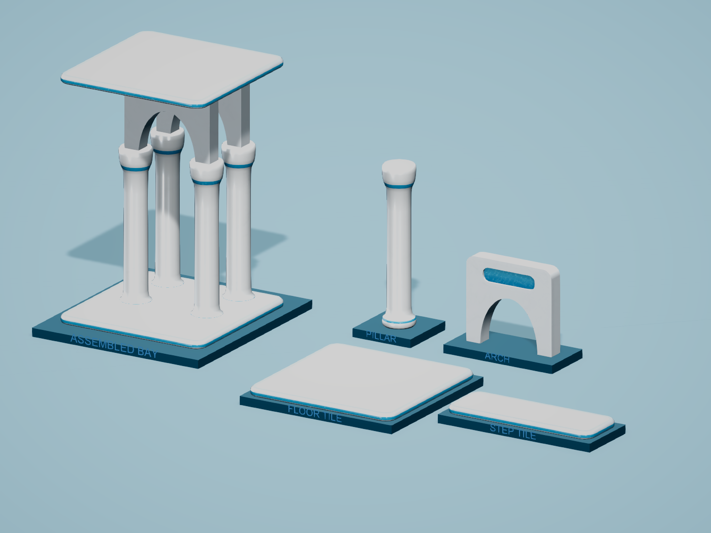
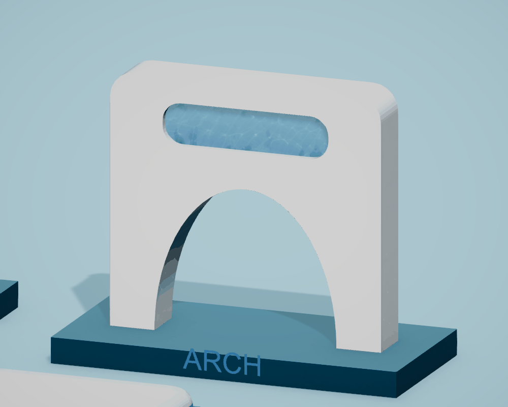
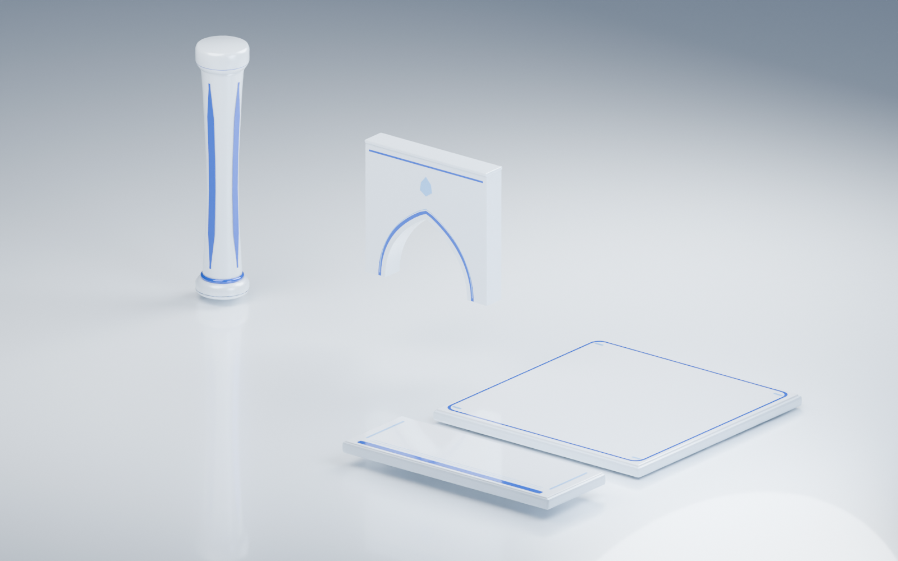
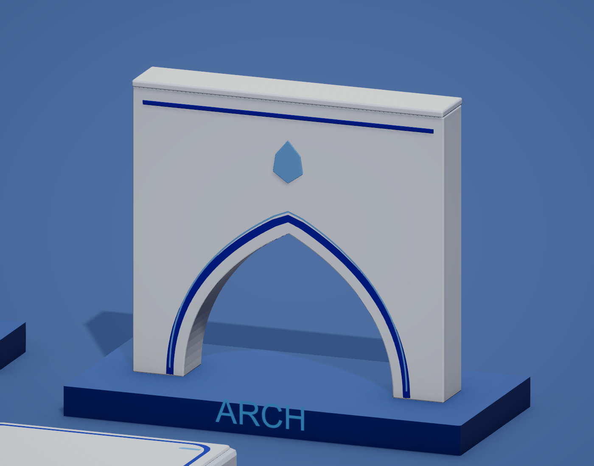
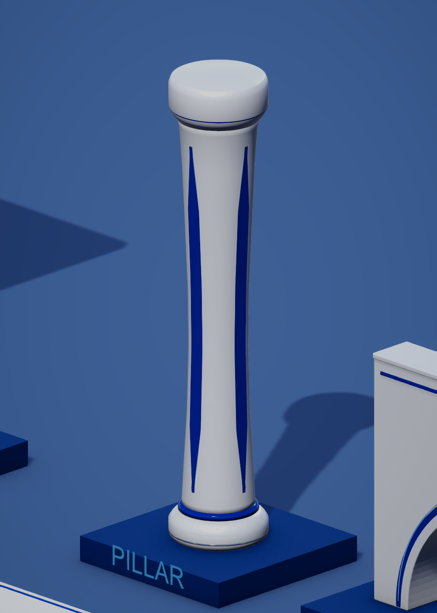
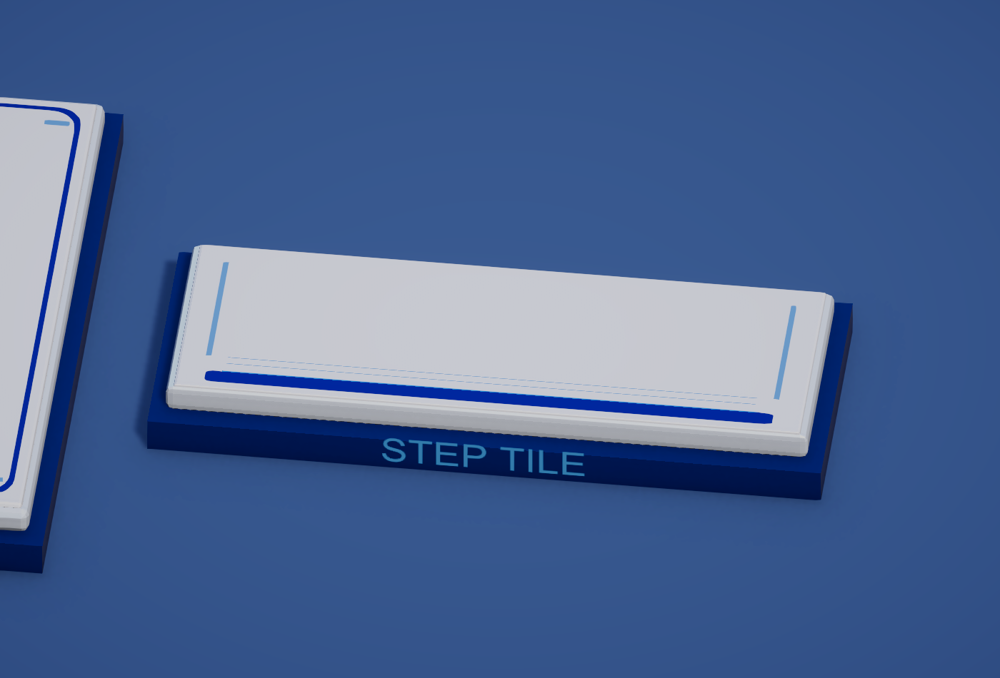
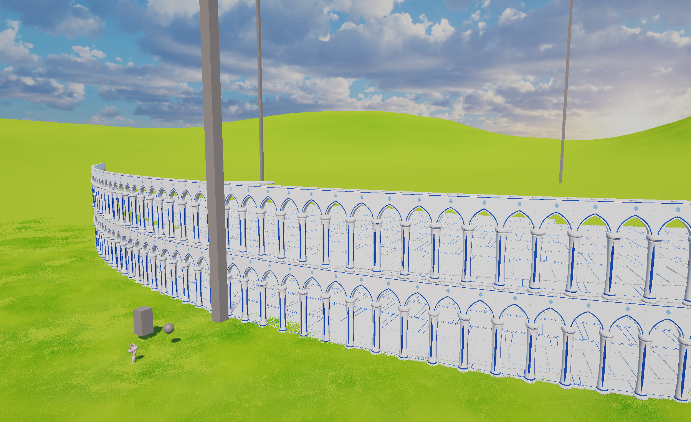

# Frutiger Aero building kit

The 2026-10-25 [building finish pass](BUILDING_FINISH.md) adds bounded live floor reflections, shared environment reflections, pearl polish, deeper aqua inlays, subtle iridescent rims, filtered glints and steady recessed-edge accents. It retains this opaque kit and the separate enclosed glass river. [Review captures and motion](../../../_Screenshots-and-previews-to-delete/Documentation/FrutigerAero/Buildings/Finish/) are available; the 2 ms GPU target remains unconfirmed following a native graphics-driver crash during additional profiling.

Current floor correction: [distant tile visibility and continuous marble/glass joins](TILE_VISIBILITY_AND_JOINS.md), including validation and tower previews.

Opaque aquatic finish restored, 2026-10-21. The subsequent see-through border experiment was rejected by the user.

The primary target is now `frutiger-building-sample-2.jpg`, explicitly selected by the user. The kit also follows the ten images in `Assets/_Project/References/Buildings/` and the supplied red arch annotation, preserved at `Frutiger Reference/Asset/Building-Arch-Full-Spandrel-User.png`. The building palette is white with blue details. No green colors occur in its eight-color palette. Older UI references using green do not override this building brief.

See [the current aquatic finish](AERO_FLOW_SHADER.md) for moving water, material controls and verification. [Aquatic architecture](AQUATIC_ARCHITECTURE.md) remains the current geometry direction. [See-through borders](BORDER_GLASS.md) are a rejected experiment retained as history.

## Design

- **Arch:** full white marble spandrel with a curved elliptical opening, rounded edges and actual recessed aqua panels and a flat upper bearing. The original curved strip's empty upper corners are filled.
- **Floor_Tile:** polished white marble slab with an integral aqua side band and smoother rounded edges.
- **Pillar:** replaced on 2026-10-30 by the [Bubble Tube pillar](BUBBLE_TUBE_PILLAR.md): a pearl base and cap with a glass water tube, a pearl spine and rising bubbles. Bubbles and water motion vary per instance. The earlier continuous white support with aqua collars is retained as history.
- **Step_Tile:** matching white tread with a rounded white nosing and aqua side band.

All assets use one root MeshFilter, one root MeshRenderer and one submesh. Each model has one opaque preset using the shared `TowerOfBabel/Buildings/Aquatic Finish` shader. The active finish supports the existing instanced renderer and submesh zero. The glass keyword is disabled on all four presets and the extra renderer feature has been removed from both PC and mobile renderers.

## Current aquatic finish

The white marble reference remains the subtle base texture. The latest shader request reintroduces controlled water animation in the blue glazing and narrow borders while retaining the white architectural forms.

- Predominantly white stone with faint gray veins, aqua recesses and frosted glass borders.
- Opaque URP PBR lighting, clear coat, soft Fresnel edges, shadows, depth and matching animated depth normals.
- Triplanar marble mapping combines with unique UV0 baked color/normal/AO maps. Mirror wrapping softens marble repeat boundaries; per-building offsets vary vein placement. UV1 retains palette coordinates.
- Vein strength 0.10, scale 0.28 repeats per metre, inlay tint strength 0.10; polish and water intensity vary by model. Flowing ripple normals and two apparent caustic layers use stable per-instance variation. Glazing remains opaque; fine water detail fades out by 85 m. Border width/strength are restored to 0.11 m/0.7.
- The current low-poly revision changes mesh detail while retaining prefab structure, outer bounds and gameplay configuration.

The geometry reduces the four-model triangle total from the earlier 10,620-triangle rounded kit to 3,012 (71.6%) and uses actual rounded shells and recessed panels, with baked normals and AO. This shader revision does not change the meshes. See [current geometry](AQUATIC_ARCHITECTURE.md). The [earlier classical low-poly revision](LOW_POLY_AERO.md) and [rounded geometry notes](MARBLE.md#rounded-geometry-and-normal-map) are retained as history.

The shader retains the supplied marble image and generated seamless technical water fields. The animation above shows the restored opaque finish; current material details are in [AERO_FLOW_SHADER.md](AERO_FLOW_SHADER.md). The desktop Editor was inspected; no mobile build was performed.

The current material is authored and rendered in Unity. The low-poly Blender source contains the high-detail geometry used to bake the ornament; final marble lighting and material controls are authored in Unity.

## Preserved structure

The original four prefab paths and GUIDs are retained under `Assets/_Project/Prefabs/Buildings/`. Root positions, rotations, scales, root component references, costs, interaction timings, outline settings and asset types are retained. There are no new child hierarchies or runtime scripts. All eleven construction-stage mesh slots now reference the corresponding new mesh, matching the previous use of one mesh for every stage.

| Asset | Mesh bounds in local metres | Prefab scale | Imported triangles | Collider |
| --- | --- | --- | ---: | --- |
| Floor_Tile | X 0–4, Y −0.2–0, Z −4–0 | 1, 1, 1 | 284 | Original box |
| Step_Tile | X 0–4, Y −0.2–0, Z −4–0 | 1, 1, 0.35 | 284 | Original box |
| Pillar | X/Z approximately ±0.410023, Y 0–4 | 1, 1, 1 | 764 | Original capsule |
| Arch | X −0.194899–2.156904, Y 0–2.15, Z ±0.2 | 1, 1, 1 | 1,680 | Nonconvex mesh with open passage |

The step remains 1.4 metres deep after its existing prefab scale. Tile corner pivots and the pillar's base pivot are preserved.

The arch's upper plane is calculated from the current tower generator: a 6-metre level pitch minus its 3.85-metre arch offset gives a local arch height of 2.15 metres. The next floor is placed at 6.2 metres and has a 0.2-metre thickness, so its underside meets the arch at 6 metres. A later change to the level pitch or arch offset will require adjusting this geometry. The old arch box collider was replaced because it would block the opening and would not cover the extended upper panel.

## Files for review and editing

- `Assets/_Project/Scenes/BuildingAeroReview.unity` — saved studio scene containing the four individual pieces and a two-arch assembled bay. Not added to Build Settings.
- `ArtSource/Buildings/FrutigerAero/BuildingKit_AquaticArchitecture.blend` — current rounded architecture and bake sources. Earlier source files and scenes are retained.
- `Assets/_Project/Models/Buildings/FrutigerAero/` — four FBX files, four active white marble presets, the marble reference texture, earlier material iterations, palette/PBR maps and studio presentation materials.
- `Tools/BuildingAero/build_aquatic_architecture.py` — current Blender MCP source, using `build_lowpoly_baked.py` for geometry, UV, bake and FBX helpers. `build_assets.py` retains the previous rounded version.
- `Tools/BuildingAero/ImportBuildingAero.cs` — Unity MCP `script eval_file` authoring snippet for import and prefab updates. Run in Edit Mode in this project.
- `Tools/BuildingAero/BuildReviewScene.cs` — Unity MCP authoring snippet that reconstructs the studio scene. Requires a saved current scene.
- `Assets/_Project/Shaders/BuildingAquaticFinish.shader` and `BuildingAquaticFlow.hlsl` — current opaque instanced URP marble/glaze shader and moving water helpers.
- `Assets/_Project/Shaders/BuildingWhiteMarble.shader` — historical static marble shader, retained as an alternative.
- `Tools/BuildingAero/ApplyWhiteMarble.cs` — current Unity MCP material, texture-import and prefab configuration.
- `Tools/BuildingAero/CaptureWhiteMarble.cs` — current `AeroFlow-*` still review captures; restores the camera afterward.
- `Tools/BuildingAero/RestoreAquaticFinish.cs` — restores the opaque presets and removes the rejected glass feature from the project renderers.
- `Tools/BuildingAero/ConfigureBorderGlass.cs` and `CaptureBorderGlass.cs` — historical rejected glass authoring; do not run unless the user requests that experiment again.
- `Tools/BuildingAero/CaptureAquaticFlow.cs`, `CaptureLiveAquaticFlow.cs` and `assemble_aquatic_previews.py` — controlled and live-clock visual captures, instance comparisons and animated preview assembly.
- `Tools/BuildingAero/bake_marble_normal.py` — Cycles tangent-space normal-map bake for vein relief and mineral grain.
- `Assets/_Project/Shaders/BuildingWaterGlass.shader` — superseded instanced URP water-glass shader, retained as iteration history.
- `Tools/BuildingAero/make_caustics.py` — reproducible seamless caustic texture generation.
- `Tools/BuildingAero/ApplyWaterGlass.cs` — earlier glass material configuration; running it explicitly reinstates the superseded glass experiment.
- `Tools/BuildingAero/update_blender_glass.py` — Blender MCP source-material update; run after rebuilding the original geometry.
- `Tools/BuildingAero/CaptureLayeredWater.cs` and `CaptureInnerWater.cs` — historical water-material captures.

The FBX exporter uses baked axes and units; import uses baked axis conversion with unit file scale. Imported mesh bounds were inspected directly before replacement.

## Current validation

The opaque aquatic finish was restored through Unity API changes and inspected in Edit Mode renders. Shader/C# compilation are clean; all four glass keywords are off and both renderer features are removed. No automated tests or Play Mode session were run for the restoration. The original clean Tower scene is restored in Edit Mode. See [restoration record](AquaticFinishRestored.json) and [aquatic finish verification](AERO_FLOW_SHADER.md#verification).

## Historical validation

No automated tests were created or run. Validation used asset inspection, shader diagnostics, console inspection, collider raycasts and the explicitly authorized Play Mode sessions.

- Review scene: confirmed frames advancing, all stage meshes resolving to the new assets, the arch passage remaining clear, and solid upper-panel collision.
- Tower scene: confirmed frames advancing with **84,629 cached assets** across **965 chunks**, **717 nearby instances**, and **83,912 distant instances**. All four near-pool model types use the new atlas material and single-submesh meshes; all 44 far stage batches use the new material. All 98 nearby arch colliders had nonzero volume.
- Original geometry validation found no URP Lit shader errors. Existing Input Manager and FishNet deprecation warnings predate this asset change.
- Inspected the palette pixels: eight white/blue colors, no green hue colors.
- Restored the original `Tower.unity` scene in clean Edit Mode and restored Run In Background to its original off setting. Temporary runtime cameras disappeared on exiting Play Mode.

Inspection details are preserved in the adjacent `*Inspection.json`, `TowerRuntimeSummary.json`, `ImportReport.json` and `FinalEditorState.json` files.

The subsequent glass revision was inspected in both the review scene and the live Tower scene. All 44 far-stage material batches and all 717 nearby assets resolved to the water-glass shader; 83,912 distant instances remained loaded. Shader compiler diagnostics were empty. Two live captures with a fixed camera and the normal engine clock changed 84,322 pixels by more than two color levels, confirming water motion (`WaterGlassMotionInspection.json`). `WaterGlassTowerInspection.json` records the renderer/material inspection.

The console buffer retained an `Outline` destroyed-reference exception in the interaction raycaster's cleanup path, plus a failed console-command lookup during inspection. Neither was a glass shader diagnostic. The cleanup exception is outside this material change and remains unresolved; see `WaterGlassConsoleInspection.json`. No automated tests were created or run.

The inner-water correction was subsequently inspected in Unity Play Mode using a fixed camera, the normal engine clock and the saved shared material. `InnerWaterMotionInspection.json` records the live frame/time values and image differences; `InnerWaterConsoleInspection.json` records console messages since the start of that verification. The `WaterGlass-Inner-*` previews supersede the faint earlier water-glass previews. The final editor was restored to the clean Tower scene in Edit Mode with Run In Background off.

The unchanged tower generator overlaps rotated floor tiles, so thin blue perimeter marks can be partly covered where neighboring tiles overlap. The isolated studio scene shows the complete asset outlines. Tower screenshots also include the project's existing green landscape and gray prototype objects; those were not part of the building replacement.

## Historical additional views

