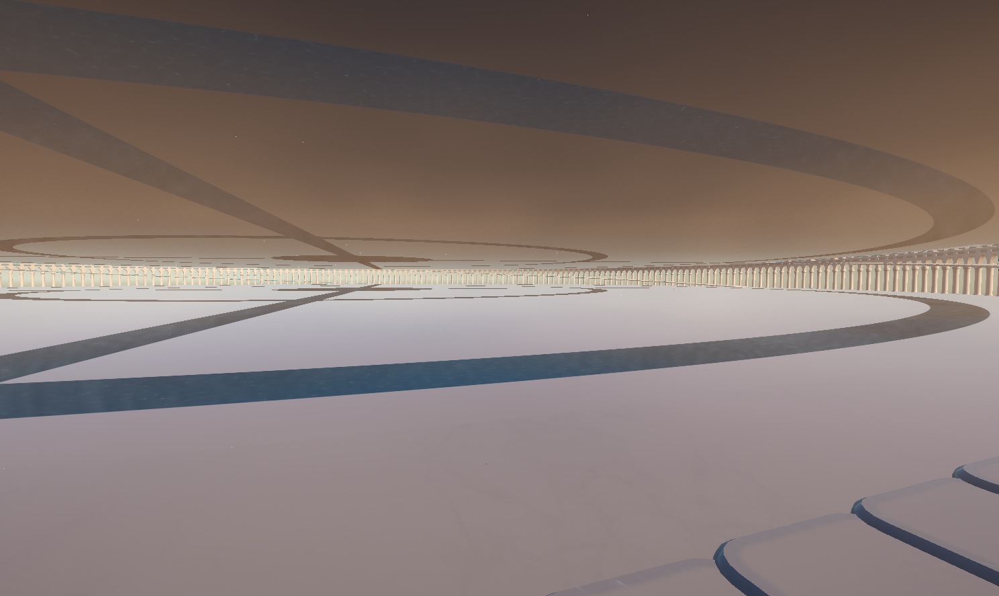

# Distant tiles and continuous floor joins

2026-10-24. Repairs the disappearing river/floor tiles and the grid-shaped joints reported in the [user reference](../../../Frutiger%20Reference/Asset/Tile-Gaps-And-Distance-Culling-User.png).

## Changes

- The saved far renderer has an older four-model override list. It now supplements missing types from `ChunkManager.AssetPrefabs`, so glass water floors render at distance. Explicit overrides remain authoritative. Stage 0 stays near-only; built stages remain eligible for distant rendering and the existing floor progression gate still applies.
- Instanced pages hold at most **511 non-uniform transforms**. These shaders need both transform matrices; the 1,023-instance ceiling requires a uniform-scaling assumption that radial tiles cannot use. See [Unity's RenderMeshInstanced limits](https://docs.unity3d.com/6000.0/Documentation/ScriptReference/Graphics.RenderMeshInstanced.html). The ray benchmark fixture uses the same safe limit.
- Completed stone and glass use one **296-vertex, 268-triangle** closed slab with 16 angular spans, full joining edges, and no inset walking surface. Bounds remain X 0–4, Y −0.2–0, Z −4–0. Stage 0–9 geometry, cached tile positions, support bridges, stair openings, resource costs and progression are retained. The completed collision mesh closes at the centre at the normal floor datum.
- Horizontal radial marble faces no longer receive a procedural aqua frame, a baked bevel normal, or baked tile-edge AO. Marble coordinates are continuous in world space. Actual aqua side bands remain.
- White portions of the glass tiles use the same marble textures, relief, polish and PBR lighting as the regular floor. Their former brighter shading made the tile boundaries look open even when geometry met. Water/glass highlights follow the continuous river boundary, rather than restarting around each tile. Reflections, flowing caustics and completed-tile projection lights remain.

`TowerTileRepairAuthoring.Apply()` authors the shared mesh, stage-10 prefab references and matching marble settings through Unity APIs. Both the island authoring workflow and the floor import workflow reapply it. `Tools/BuildingAero/radial_floor_patch.py` records the matching flush 16-span source shape. Existing Blender/FBX bake sources remain as historical inputs; the current completed mesh is `FloorTileComplete.asset`.

## Verification

**72 Edit Mode checks and 10 final automated Play Mode checks passed**, with no failures. The Edit Mode run includes native GPU pixel coverage for all 1,024 instances of each tile type, the legacy override-list regression, shared finished edge geometry, angular closure, centre closure, and rendered marble/glass-surround comparisons from above and below. Existing world, support, progression, lighting, projection and firefly checks also passed. Final Play Mode was entered only through Unity's automated test runner.

The disposable `TowerTileVisualReview.Capture(floor)` renders completed floor/ceiling data through the actual near pool and far renderer. Floors **0, 20 and 42** were reviewed from above and below. It restores the original scene and lighting context. These are geometry/material reviews with a fixed morning lighting time; they are not matched lighting comparisons against the live before capture, and they do not measure GPU performance. No new performance-budget claim is made.

- [Validation record](TileFixValidation.json)
- [Live before capture](Previews/Tile-Bugs-Before-Live.png)
- [Repaired interior at the reported camera angle](Previews/Tile-Fix-Interior.png)
- [Ground-floor joins](Previews/Tile-Fix-Floor0-Joins.png) and [underside](Previews/Tile-Fix-Floor0-Underside.png)
- [Shrinking floor 20](Previews/Tile-Fix-Floor20-Joins.png) and [upper-floor underside](Previews/Tile-Fix-Floor42-Underside.png)
- Native draw coverage: [stone](Previews/FarCoverage-Floor.png), [glass](Previews/FarCoverage-GlassWaterFloor.png)

